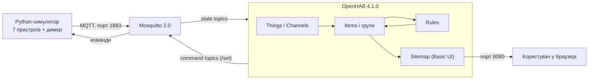
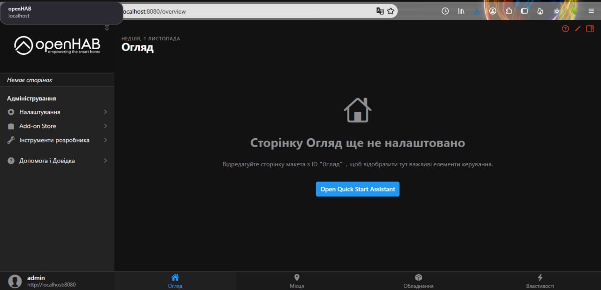
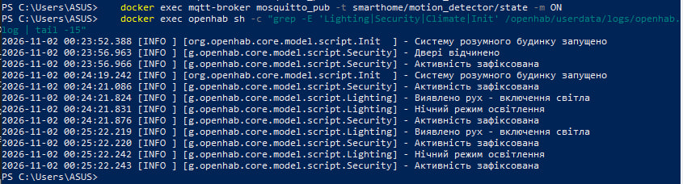

# Практична робота. Створення системи розумного будинку з OpenHAB


## 1. Титульна інформація

| Поле | Значення |
|---|---|
| Студент | Дячук Олександр Русланович  |
| Група | alk-44 |
| Дисципліна | Технології IoT та SMART-технології |
| Робота | Практична робота: створення системи розумного будинку з OpenHAB |
| Дата виконання | 14.10.2026 |

## 2. Мета роботи та завдання

**Мета:** навчитися створювати систему домашньої автоматизації на OpenHAB, інтегрувати різні типи розумних пристроїв і розробити сценарії автоматизації.

**Завдання:** (1) встановити й налаштувати OpenHAB; (2) створити MQTT-брокер і симулятор пристроїв; (3) налаштувати Things та Channels; (4) створити Items і групи; (5) розробити правила автоматизації; (6) створити користувацький інтерфейс (Sitemap); (7) протестувати систему; (8) розширити функціональність; (9) оформити звіт.

## 3. Архітектура розробленої системи



Симулятор публікує стани пристроїв у MQTT-теми `smarthome/<пристрій>/...`, OpenHAB через MQTT Binding перетворює їх на Channels, які прив'язані до Items. Правила реагують на зміну Items і надсилають команди назад у MQTT, а симулятор їх виконує.

## 4. Структура репозиторію

```
docker-compose.yml           OpenHAB + Mosquitto (завдання 1.1, 2.1)
mosquitto/config/mosquitto.conf
conf/services/runtime.cfg    регіональні налаштування (завдання 1.3)
conf/services/addons.cfg     автоінсталяція MQTT Binding
simulator/smart_home_simulator.py   симулятор (завдання 2.2, 8.1)
conf/things/smarthome.things        Things і Channels (завдання 3)
conf/things/extensions.things       димер кухні (завдання 8.1)
conf/items/smarthome.items          Items і групи (завдання 4)
conf/items/extensions.items         димер і сценарії (завдання 8)
conf/rules/lighting.rules, climate.rules, security.rules, init.rules   (завдання 5)
conf/rules/dimmer.rules, scenes.rules                                  (завдання 8)
conf/sitemaps/demo.sitemap          інтерфейс (завдання 6)
screenshots/                        скріншоти для звіту
```

## 5. Хід виконання (за завданнями)

### Завдання 1. Встановлення й базове налаштування

```
docker compose up -d
```

Перший запуск OpenHAB займає кілька хвилин. Далі відкрити <http://localhost:8080>, створити обліковий запис адміністратора й пройти майстер початкового налаштування. Регіональні параметри (`uk`, `UA`, `Europe/Kiev`) задано в `conf/services/runtime.cfg`.



*Рис. 1. Головна сторінка OpenHAB після налаштування.*

OpenHAB і Mosquitto запущено командою `docker compose up -d`, у веб-інтерфейсі створено адміністратора. Спочатку список Things був порожнім, бо Docker запускався з папки лише з файлами першого кроку, без `conf/things` та інших. Після злиття файлів у одну папку й `docker compose restart` Bridge і всі Things стали ONLINE.

### Завдання 2. Симулятори IoT-пристроїв

Брокер Mosquitto запускається разом з OpenHAB командою вище. Симулятор:

```
cd simulator
pip install -r requirements.txt
python smart_home_simulator.py
```

Перевірка публікацій (потрібен `mosquitto_sub`, або команда всередині контейнера):

```
docker exec mqtt-broker mosquitto_sub -t "smarthome/#" -v
```

### Завдання 3. Things і Channels

Файл [`conf/things/smarthome.things`](conf/things/smarthome.things) описує Bridge `mqtt:broker:localBroker` і сім Things: три лампи, термостат, датчик руху, датчик дверей, розумну розетку.


*Рис. 3. Усі Things зі статусом ONLINE (Settings → Things).*

### Завдання 4. Items і групи

Файл [`conf/items/smarthome.items`](conf/items/smarthome.items): 8 груп, 13 Items, прив'язаних до каналів, і 4 віртуальні Items (`AllLights`, `HomeMode`, `ComfortIndex`, `LastActivity`).


*Рис. 4. Сторінка Settings → Items.*

### Завдання 5. Правила автоматизації

| Файл | Що реалізовано |
|---|---|
| [`lighting.rules`](conf/rules/lighting.rules) | світло за рухом (день 80 %, ніч 30 %), вимкнення через 5 хв; керування всім світлом; вечірній режим о 19:00; нічний о 23:00 |
| [`climate.rules`](conf/rules/climate.rules) | цільова температура за часом доби й присутністю, індекс комфорту, попередження про аномальну температуру |
| [`security.rules`](conf/rules/security.rules) | облік активності, режим AWAY/HOME, контроль дверей, моніторинг розетки |
| [`init.rules`](conf/rules/init.rules) | початкові значення `HomeMode` і `LastActivity` |



*Рис. 5. Виконання правил у логах (`docker logs -f openhab` або `userdata/logs/openhab.log`).*

### Завдання 6. Інтерфейс (Sitemap)

Файл [`conf/sitemaps/demo.sitemap`](conf/sitemaps/demo.sitemap): огляд, швидкі дії, сценарії, освітлення за кімнатами, клімат, датчики безпеки, енергоспоживання. Відкривається за адресою <http://localhost:8080/basicui/app?sitemap=demo>.


*Рис. 6. Основний інтерфейс Sitemap.*

### Завдання 7. Тестування

Нижче потрібно записати **фактичні** результати з вашого запуску.

| № | Сценарій | Дії | Очікувано | Фактично | OK? |
|---|---|---|---|---|---|
| 1 | Автоосвітлення | `docker exec mqtt-broker mosquitto_pub -t smarthome/motion_detector/state -m ON` | світло у вітальні вмикається (80 % удень, 30 % вночі); через 5 хв вимикається | У лозі о 00:25:22: «Виявлено рух - включення світла», «Нічний режим освітлення» (була ніч), «Активність зафіксована». Автовимкнення зафіксовано записами «Автоматичне вимкнення світла». | так |
| 2 | Клімат | змінити цільову температуру в інтерфейсі й через `mosquitto_pub` | змінюється стан обігріву; `ComfortIndex` перераховується | Правило повертає цільову температуру за розкладом: у лозі «Зміна температури: 21.0°C -> 19.0°C (присутність: true)» тощо. Індекс комфорту змінюється (6.0 → 6.8 → 9.2). За поточної температури 18.6 °C і цільовій 19.0 °C «Обігрів» = ON. | так |
| 3 | Режим відсутності | у `security.rules` тимчасово замінити `120` на `2`, не створювати активності 15–20 хв | `HomeMode` = AWAY; потім після руху → HOME | ЗАПОВНІТЬ після перевірки | |
| 4 | Керування з MQTT | `mosquitto_pub -t smarthome/living_room_light/set -m ON` | Item `LivingRoomLight` стає ON | ЗАПОВНІТЬ після перевірки | |
| 5 | Захист розетки | `mosquitto_pub -t smarthome/smart_socket/power -m 250` | у логах «Критичне споживання», розетка OFF | У лозі: «Високе споживання розетки: 250 Вт» і «Критичне споживання! Вимкнення розетки»; `SmartSocket` = OFF. | так |

**Примітка до сценарію 5.** Симулятор генерує споживання 50–200 Вт, тому правило автовимкнення при `> 200 Вт` у штатному режимі не спрацює. Щоб його перевірити, потрібно вручну опублікувати значення понад 200, як у таблиці.

**Примітка до сценарію 3.** Після перевірки поверніть значення 120 назад.

**Аналіз логів.** (1) Під час тестів правила `Lighting`, `Climate`, `Security`, `Energy` виконувались без помилок. (2) На початку в лозі був `ERROR ... security-1 ... getName() on null`: змінна `triggeringItem` у правилі «Відстеження активності» порожня; рядок виправлено (прибрано звернення до `triggeringItem.name`), після перезапуску помилка зникла. (3) `WARN ... /openhab/conf/transform` означає лише відсутню папку трансформацій, а `WARN ... /rest/events` з'являються, поки відкрита вкладка браузера, а OpenHAB перезапускається; обидва нешкідливі. (4) Правило клімату повертає цільову температуру за розкладом одразу після ручної зміни, тому в журналі багато записів «Зміна температури: x -> 19.0».

## 6. Розширення функціональності

### 6.1. Розумний димер кухні (завдання 8.1)

1. **Симулятор:** пристрій `kitchen_dimmer` у [`smart_home_simulator.py`](simulator/smart_home_simulator.py). Рівень змінюється плавно: на 5 % кожні 0,3 с до цільового значення, під час руху публікуються проміжні рівні.
2. **Thing:** [`extensions.things`](conf/things/extensions.things).
3. **Items:** `KitchenDimmerPower`, `KitchenDimmer` у [`extensions.items`](conf/items/extensions.items).
4. **Sitemap:** перемикач і повзунок на сторінці «Кухня».
5. **Правила:** [`dimmer.rules`](conf/rules/dimmer.rules): 40 % о 19:30, вимкнення о 23:00, логування змін.

### 6.2. Сценарні режими (завдання 8.2)

Item `SceneMode` і правило в [`scenes.rules`](conf/rules/scenes.rules) для режимів MORNING, DAY, EVENING, NIGHT. У Sitemap додано вибір сценарію (Selection) з підписами «Ранок / День / Вечір / Ніч».


## 7. Висновки

**Досягнуті результати.** Запущено OpenHAB 4.1.0 і Mosquitto через `docker compose`; симулятор публікує стани 7 пристроїв і розумного димера; Bridge і 8 Things мають статус ONLINE; створено 28 Items (з групами); працюють правила освітлення, клімату, безпеки й енергоспоживання, інтерфейс Sitemap, димер кухні з плавною зміною рівня (виявлено команду `kitchen_dimmer/level -> 54`). Результати тестів 3 і 4 та сценаріїв: ЗАПОВНІТЬ після перевірки.


**Проблеми, які виникли під час запуску.** (1) Список Things був порожнім через неповну структуру `conf`: файли з різних кроків лежали в різних папках; усе злито в одну папку. (2) Помилка `triggeringItem` в `security.rules` (див. аналіз логів): рядок виправлено. (3) На Windows OpenHAB не перечитує змінені файли `conf` автоматично: після кожної правки потрібен `docker compose restart openhab`. (4) Спочатку OpenHAB після перезапуску 2–3 хвилини недоступний (`health: starting`): потрібно було зачекати.

## 8. Відповіді на контрольні питання

1. **Things, Items, Channels.** Thing - фізичний пристрій або сервіс (у нас `thermostat`). Channel - окрема функція Thing (`current_temp`). Item - логічний об'єкт стану (`CurrentTemperature`), що прив'язується до Channel і є тим, з чим працюють правила та інтерфейс.
2. **Правила.** Правило складається з тригера (`when`: зміна Item, команда, `Time cron`, запуск системи) і дії (`then`). Виконується в момент події тригера.
3. **Переваги MQTT.** Легкий протокол «публікація/підписка», мала затримка, роз'єднує виробника й споживача даних, підходить для слабких пристроїв.
4. **Енергоефективність.** Режим AWAY (вимкнення світла, зниження цільової температури), автоматичне вимкнення світла, економний нічний/денний режим, моніторинг споживання розетки.
5. **Безпека.** Незахищений MQTT (немає пароля й TLS), слабкі паролі, відкритий порт 8080 назовні, фальшиві команди, витік даних про присутність у домі, застарілі прошивки.
6. **Масштабування.** Структура «Thing → Item → група → правило» і окремі файли конфігурації; додавання пристрою - це новий Thing, Items і запис у Sitemap (як у димері).
7. **Налагодження.** Логи OpenHAB, `mosquitto_sub -v` для MQTT-трафіку, `mosquitto_pub` для імітації подій, статус Things в інтерфейсі.

## 9. Декларація використання штучного інтелекту

**Під час виконання цієї роботи засоби систем штучного інтелекту не використовувались.** 
